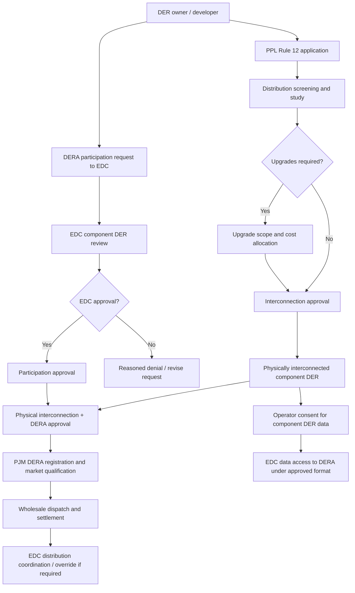

# Casebook: Pennsylvania Distribution DER Interconnection and PJM Wholesale Aggregation

**Research setting:** Pennsylvania / PJM  
**Verification date:** 2026-11-20  
**Purpose:** A primary-source case study connecting distribution interconnection, state regulation, utility operations, and wholesale market participation.

!!! warning "Public-source research only"
    Use only publicly available tariffs, orders, manuals, data, and publications. Do not use employer-confidential processes, internal system data, customer information, nonpublic project records, or work product. This casebook is an independent academic exercise, not an assessment of any employer's performance.

## Why this case matters

Two different institutional processes can affect a distributed resource:

1. The distribution-level process for physically connecting a DER to a utility distribution system.
2. The RTO/ISO wholesale-market process through which an aggregation may participate in energy, capacity, or ancillary-service markets.

They are related but not interchangeable. A DER's physical interconnection and distribution-system operating requirements do not disappear because the resource participates through an aggregator in a wholesale market.

## Primary-source packet

### A. PPL Electric Utilities — current Rule 12 tariff

**Current document:** PPL Electric Utilities Corporation, Supplement No. 2 to Electric Pa. P.U.C. No. 202, Rule 12 — Distributed Energy Resource Interconnection Service. Issued June 30, 2026; effective July 1, 2026.  
**Official PDF:** [Current Rule 12, Supplement No. 2 to Electric Pa. P.U.C. No. 202](https://www.pplelectric.com/site/-/media/PPLElectric/At-Your-Service/Docs/Current-Electric-Tariff/2026/August/Rule-12---Distributed-Energy-Resource-Interconnection-Service.pdf).

The current tariff states that Rule 12 applies to new DER interconnections effective January 3, 2026 and to inverter-based DER applications received on or after that date, subject to the specified rate schedules. It specifies IEEE 1547-2018 and UL 1741 Supplement B (or current utility certification requirements) for smart inverters and describes utility-owned DER Management Devices and DERMS functions.

**Version-control note:** Earlier 2026 PUC No. 201 tariff supplements remain useful for historical chronology, but the current Rule 12 reference located in this review is Supplement No. 2 to PUC No. 202, effective July 1, 2026. Do not label the April 2026 PUC No. 201 tariff as the current Rule 12 document.

### B. PPL public DER Management Program and implementation

- [PPL DER Management Program](https://www.pplelectric.com/site/More/For-Construction/DER-Management)
- [PPL REMSI page](https://www.pplelectric.com/site/More/About-Us/Electric-Rates-and-Rules/REMSI)

PPL describes its DERMS, utility-owned/maintained DER Management Devices, and communication with participating customer smart inverters. PPL's REMSI page states that implementation of its Second DER Management Program began January 5, 2026. Keep that implementation milestone separate from the Rule 12 tariff effective date of January 3, 2026.

### C. Pennsylvania PUC — Second DER Management Plan order

**Docket:** P-2024-3049223.  
**Order date:** December 3, 2025, as cited in the PUC Chairman's prepared testimony to the House Energy Committee on March 16, 2026.  
**Official public source located:** [Prepared Testimony of PUC Chairman Stephen M. DeFrank, March 16, 2026](https://www.palegis.us/house/committees/committee-archives/archive-file?file=2026_0572_0009_TSTMNY.pdf), page 3 and footnote 5.

The Chairman's testimony states that the Commission approved PPL's Second DER Management Plan at its November 20, 2025 public meeting, with the order entered December 3, 2025. It reports that the plan is projected to increase hosting capacity by up to 258 MW and that the Commission directed PPL to conduct an RFP for third-party aggregators.

**Evidence qualification:** The 258 MW figure is a projection reported in the Chairman's testimony, not an independently measured ex-post increase. The testimony is not a substitute for the controlling order. Retrieve the original order and docket record from the [PA PUC Document Search](https://www.puc.beta.pa.gov/search/document-search/) before making detailed claims about ordering paragraphs, cost recovery, evaluation requirements, reporting, or RFP terms.

### D. DER Orchestration Plan and BTM non-exporting battery review

The March 13, 2026 rate-case settlement in R-2025-3057164 contains follow-through commitments on a DER Orchestration Plan and a review of BTM non-exporting battery applications. The operative settlement body paragraphs are 119 (one stakeholder working group before the plan filing) and 124 (review of BTM projects currently under interconnection review within 120 days of the June 11, 2026 final order). Appendix D contains off-by-one cross-references to paragraphs 118 and 123; use the operative settlement body numbering. The 120-day review date was October 9, 2026. No separate public report or plan was located in the indexed sources searched as of November 20, 2026; that is a public-record search status, not proof of non-filing. The 2023 PPL storage policy and 2026 Rule 12 supplement should be read together.

See [DER Orchestration Plan and BTM Storage Review](der-orchestration-and-btm-storage-review.md) for the detailed chronology, technical policy crosswalk, deadline, public-record caveat, and research questions.

### E. PPL hosting-capacity transparency and Pennsylvania HB 2429

PPL's [public interconnection FAQ](https://pplelectric.com/site/More/About-Us/Electric-Rates-and-Rules/Customer-Owned-Generation/frequently-asked-questions) states that it does not currently publish hosting-capacity maps or specific feeder hosting-capacity information. It says that limited site-specific information may be provided during pre-application, including substation name, feeder name and voltage, and line-distance information.

[House Bill 2429, Printer's No. 3230](https://www.palegis.us/legislation/bills/text/PDF/2025/0/HB2429/PN3230) was introduced and referred to the House Energy Committee on April 20, 2026. As introduced, it would require EDC hosting-capacity maps by July 1, 2027, updated every two months, with DER and new-load capacity, queued DER, distribution constraints, feeder-level granularity, planned upgrades, voltage levels, and limiting criteria. The version reviewed shows committee referral, not enactment. Treat this as proposed legislation unless an updated official bill history confirms otherwise.

See the [public-data feasibility assessment](data-feasibility.md) for the dataset inventory, research design, and unresolved evidence gaps.

### F. Pennsylvania PUC — proposed Chapter 57 rules for wholesale DER aggregations

**Docket:** L-2023-3044115.  
**Order:** Notice of Proposed Rulemaking adopted and entered December 18, 2025; published April 11, 2026 in 56 Pa.B. 1985.  
**Official sources:** [Pennsylvania Bulletin NOPR, Doc. No. 26-527](https://www.pacodeandbulletin.gov/secure/pabulletin/data/vol56/56-15/527.html); [IRRC Regulation No. 57-346 status page](https://www.irrc.state.pa.us/regulations/RegSrchRslts.cfm?ID=3496).

The proposed rules would create 52 Pa. Code §§ 57.261–57.266 for DER Aggregation Resources participating in PJM energy, capacity, and/or ancillary-services markets. The proposal is not final law. The IRRC page currently lists the regulation as proposed, with the public-comment period closed July 9, 2026, no final-form regulation received, and a final-form due date of July 9, 2028.

Key features of the proposal include:
- Net-metered customer-generators would generally be excluded from wholesale energy and capacity participation as DER Aggregator Resources, while ancillary-services participation could be allowed under the proposed conditions.
- A Component DER would require EDC approval to participate as part of a DER Aggregation Resource.
- An EDC would establish an electronic review process, complete review within 60 days, and explain denials.
- An EDC could propose application/review fees through a tariff filing.
- EDCs would provide DERA access to Component DER data with DER-operator consent, in a Commission-approved format.
- EDCs would retain distribution-safety and reliability operating/dispatch-override procedures.

**Jurisdictional boundary:** The NOPR expressly states that the Commission will address interconnection of Component DERs in another proceeding. Do not treat this proposed wholesale-aggregation rulemaking as the distribution interconnection rule or as a replacement for PPL Rule 12. Also distinguish the proposed 60-day DERA participation review from a site-specific interconnection study timeline.

The IRRC status page is important because it prevents a proposed rule from being represented as enacted. Recheck the regulation's status and any final-form publication before relying on these requirements.

### G. PJM — DER Aggregator Participation Model

**Document:** PJM, *DER Aggregator Participation Model: Full Model Design*, March 9, 2026.  
**Official public PDF:** [PJM model design presentation](https://www.pjm.com/-/media/DotCom/committees-groups/subcommittees/disrs/2026/20260309/20260309-item-05---updated-der-aggregator-participation-model---full-model-design---informational-only.pdf).

The presentation describes the PJM implementation timeline and the division between wholesale aggregation participation and distribution interconnection. It is an informational presentation, not itself a tariff. Verify current tariff/manual language and later stakeholder/FERC actions before relying on dates or requirements.

### H. FERC — Order No. 2222

- [FERC Order No. 2222 fact sheet](https://www.ferc.gov/media/ferc-order-no-2222-fact-sheet).
- [FERC Order No. 2222 explainer](https://www.ferc.gov/ferc-order-no-2222-explainer-facilitating-participation-electricity-markets-distributed-energy).
- [FERC Order No. 2222 original order, Docket RM18-9-000](https://www.ferc.gov/sites/default/files/2020-09/E-1_0.pdf).

The order establishes a framework for DER aggregations to participate in organized wholesale markets. The fact sheet and explainer are useful orientation materials, but the order and subsequent compliance orders are the controlling sources.

### I. FERC — Order No. 2023

- [FERC explainer on the generator interconnection final rule](https://ferc.gov/explainer-interconnection-final-rule).
- [Order No. 2023, Docket RM22-14-000](https://ferc.gov/sites/default/files/2023-07/20230728-3060.PDF).
- [FERC March 21, 2024 update on Order 2023-A and compliance filings](https://ferc.gov/news-events/news/ferc-affirms-generator-interconnection-rule-acts-compliance-filings).

Study this rule to understand transmission-provider generator interconnection reforms. Do not casually conflate its large- and small-generator transmission interconnection procedures with a state-regulated distribution DER process. Determine jurisdiction from the asset, transaction, tariff, and actual order language.

### I. PPL 2025 rate case — DER orchestration and non-exporting BTM storage

**Docket:** R-2025-3057164 and consolidated complaints.  
**Settlement filed:** March 13, 2026.  
**Commission action:** The Pennsylvania PUC entered an order on June 11, 2026 approving the settlement with a minor modification related to net-metering eligibility; new rates became effective July 1, 2026. PPL's Q3 2026 Form 10-Q reports that the reconsideration petition was denied August 27, 2026 and that a Commonwealth Court appeal filed September 25, 2026 is limited to a net-metering eligibility issue.  
**Sources:** [Joint Petition for Approval of Non-Unanimous Settlement](https://www.pplelectric.com/site/-/media/ppl-jss-app/assets/Home/Landing-Pages/Public-Utility-Commission/PDFs/2026/PPL--2025-Rate-Case--Joint-Petition-for-NonUnanimous-Settlement-of-All-Issues-FINAL.pdf); [PPL Corporation Q3 2026 Form 10-Q](https://www.sec.gov/Archives/edgar/data/317187/000092222426000052/ppl-20260930.htm).

#### DER orchestration plan and DERMS cost-effectiveness

Settlement paragraph 118 (Appendix D, proposed findings 386–390) addresses the DER Orchestration Plan referenced in P-2024-3049223. It provides for one stakeholder working group before PPL files the plan, with substantive updates, stakeholder questions, feedback, and PPL's good-faith consideration of that feedback. The PUC's June 11, 2026 order approved the settlement with a minor modification related to net-metering eligibility.

Environmental Intervenors' testimony, as summarized in proposed finding 386, argued that the orchestration plan could reduce Second DER Management Plan costs and cited a figure of $1,700 per device. PPL's rebuttal, summarized in proposed finding 387, argued that the plan's timing could not affect capital costs in the fully projected future test year. **The $1,700 figure is an intervenor's position cited in proposed findings, not a Commission finding or independently verified unit cost.** Treat the cost-effectiveness question as open.

Research tasks:
- Locate the filed DER Orchestration Plan and stakeholder working-group record.
- Identify the alternatives assessed, the control/telemetry architecture, and which functions require dedicated devices versus existing inverter communications or other approaches.
- Reconstruct the $1,700/device estimate from its underlying testimony/exhibits before using it in a cost model.
- Separate capital cost, installation, communications, software, maintenance, replacement, and ongoing operating costs.
- Identify measurable benefits and counterfactuals: avoided upgrades, incremental hosting capacity, voltage excursions, curtailment, reliability, and market/aggregator value.
- Distinguish a projected hosting-capacity increase from realized, locationally available capacity and measured customer outcomes.

#### Non-exporting behind-the-meter battery storage

Settlement paragraph 123 requires PPL to review, within 120 days of the Commission's final order, BTM non-exporting battery projects then under interconnection review and determine whether the requirements being imposed align with industry best practices and available studies. The settlement's proposed findings record a disagreement: Convergent argued that PPL lacked a distinct non-exporting BTM BESS interconnection rule and applied requirements designed for generation resources; PPL responded that its Energy Storage Interconnection Policy and Guidance provided clear technical standards.

The Commission order was entered June 11, 2026. A straightforward 120-calendar-day count points to October 9, 2026, but confirm the applicable time-computation rule and any later docket direction. This review obligation is narrower than a general promise to create a new tariff or a new BESS interconnection rule; do not overstate it.

Useful source: [PPL Energy Storage Interconnection Policy and Guidance, Revision 0, effective February 1, 2023](https://www.pplelectric.com/site/-/media/ppl-jss-app/assets/Home/More/About-Us/Electric-rates-and-rules/Point-of-contact-requirements/PPL-Electric-Energy-Storage-Policy-Rev-0.ashx). The document describes non-export configurations and control-system evidence. Verify whether a newer revision exists before treating it as current.

Research tasks:
- Compare the policy's non-export configurations with the requirements PPL applied to the projects reviewed under paragraph 123.
- Define inadvertent export, protection, fail-safe controls, metering, commissioning tests, and operating limits.
- Assess whether an energy-storage-specific process is technically justified and proportionate to actual export risk.
- Locate evidence of the paragraph 123 review and any resulting policy, tariff, or guidance changes.

### I. Pennsylvania PUC — Net-Metering and Interconnection Report 2023–2025

**Official report:** [Net-Metering and Interconnection Report 2023–2025 (PDF)](https://www.puc.pa.gov/media/3770/net-metering-interconnection-report-2023-2025_final.pdf).

This is the strongest public source located so far for utility-level interconnection process outcomes. The report covers reporting years June 1 through May 31 and provides EDC service-territory data on customer-generators, interconnected nameplate capacity, request counts by review level, mean approval times, request status, and review-level changes. Detailed tables cover 2023–2025; trend figures extend request and capacity histories to 2016.

For PPL, the report records 6,844 requests in the 2025 reporting year, including 4,008 Level 1, 2,425 Level 2, and 411 Level 3 requests. It reports 592 requests pending EDC action and 852 cancelled by customers. The 2025 PPL status categories sum to 6,487, which is 357 fewer than the 6,844 submitted requests; the reported `Completed` field also includes the 592 pending-EDC cases. This is an unresolved status-table accounting discrepancy. Do not calculate a completion rate from these fields until the PUC clarifies them.

The report also shows PPL's customer-generator count increasing from 19,685 in 2023 to 28,819 in 2025, while total annual request counts moved from 7,567 to 6,844. These are descriptive reporting statistics, not a causal assessment of Rule 12 or the Second DER Management Plan.

The structured extract now covers all 11 EDC service territories for 2023–2025, and PPL ranked first in total request volume in all three years. See [PUC report analysis and measurement notes](puc-interconnection-report-2023-2025.md), the [all-EDC request-count panel](pa_edc_interconnection_2023_2025.csv), the [structured PPL metrics extract](ppl_interconnection_2023_2025.csv), and the reproducible QA scripts `analyze_pa_edc_interconnection.py` and `analyze_puc_interconnection.py` with unit tests. The casebook documents reporting-period definitions, 500 kW schema changes, request reclassification, mean-time denominator limitations, status-table arithmetic, and the distinction between EDC service territories and EIA utility IDs.

**FirstEnergy identity break:** FirstEnergy's 2023 Form 10-K states that the Pennsylvania operating companies were consolidated into FE PA effective January 1, 2024. The PUC report continues to report former service territories/rate districts separately (Met-Ed, Penelec, Penn Power, and West Penn Power), while EIA's 2025 frame lists FirstEnergy Pennsylvania Electric Co as a single respondent (EIA ID 66101). Do not compare the EIA respondent panel to the PUC territory panel without an explicit time-varying entity/territory crosswalk.

## Working artifacts

- [Versioned primary-source register](source-register.csv)
- [Institutional responsibility matrix](responsibility-matrix.csv)
- [Public-data feasibility assessment](data-feasibility.md)
- [PA PUC wholesale DER aggregation NOPR, L-2023-3044115](https://www.pacodeandbulletin.gov/secure/pabulletin/data/vol56/56-15/527.html)
- [PUC Net-Metering and Interconnection Report 2023–2025 analysis](puc-interconnection-report-2023-2025.md)
- [PPL interconnection metrics CSV, 2023–2025](ppl_interconnection_2023_2025.csv)
- [All-EDC interconnection request panel, 2023–2025](pa_edc_interconnection_2023_2025.csv)

The responsibility matrix is a research aid, not a legal opinion. Verify each assignment against the current controlling authority before relying on it.

## Process map

The two workflows below are related but legally and operationally distinct. The wholesale aggregation approval steps reflect the proposed Chapter 57 NOPR and must not be treated as final requirements.

**Timing note:** The proposed 60-day review in § 57.264 concerns the EDC's review of a request for Component DER participation as a DERA resource. It is not a substitute for the Rule 12 physical interconnection process or its study timelines.

## Research questions

1. How do distribution interconnection requirements and wholesale aggregation requirements interact for a DER in Pennsylvania?
2. Which entity is responsible for each decision: distribution utility, PJM, FERC, Pennsylvania PUC, aggregator, or resource owner?
3. What public evidence is available to evaluate interconnection process outcomes, operating constraints, and market participation?
4. What information must be exchanged between utility, aggregator, PJM, and retail regulatory authority?
5. Which aspects of the process are technically necessary, and which are institutional or economic design choices?
6. What performance evidence would be required to validate the projected hosting-capacity benefits of active DER management?

## Required analysis

### 1. Build an institutional responsibility matrix

For each process stage, identify the decision-maker, governing source, data required, affected parties, and escalation path. Include application, technical review, study, upgrades, approval, commissioning, DERMS/control requirements, aggregator registration, telemetry, dispatch, and settlement.

### 2. Build a rule crosswalk

Compare:
- PPL current Rule 12 tariff and REMSI;
- the December 3, 2025 PUC order in P-2024-3049223;
- the proposed Chapter 57 wholesale DER aggregation rules in L-2023-3044115 and their current IRRC status;
- applicable Pennsylvania PUC regulations and the wholesale DER participation rulemaking;
- PJM tariff and manuals for DER aggregations;
- FERC Order 2222 and relevant compliance orders;
- IEEE 1547 and applicable certification standards.

For each provision, identify its legal status, effective date, applicability, and relationship to the other documents.

### 3. Draw the process map

Show the physical interconnection pathway separately from wholesale market participation. Use explicit handoffs and mark where the two processes interact.

### 4. Conduct a data-feasibility review

Identify what is publicly observable: application counts, milestones, capacity, completion/withdrawal, upgrade costs, feeder location, operating limits, DER output, and market participation. For each field, document whether it is public, aggregated, incomplete, unavailable, or confidential. Do not assume data exist.

### 5. Evaluate economics and policy

Analyze how interconnection costs, upgrade allocation, operating requirements, and aggregation compensation affect project economics, ratepayers, utility planning, and system reliability. Distinguish costs caused by an individual project from shared infrastructure benefits and broader policy objectives.

## Deliverables

- 1,500–2,000 word primary-source institutional review.
- Versioned source matrix with exact sections and effective dates.
- Swimlane process diagram.
- Data-feasibility memo and data dictionary.
- 1,000–1,500 word policy brief.
- Research protocol stating whether an empirical study is feasible.

## Research integrity

The goal is to understand the public regulatory and technical framework. Do not attempt to reconstruct internal employer procedures from memory or include any nonpublic details. If public data are insufficient, reframe the project as a regulatory design and institutional analysis rather than implying empirical results.
